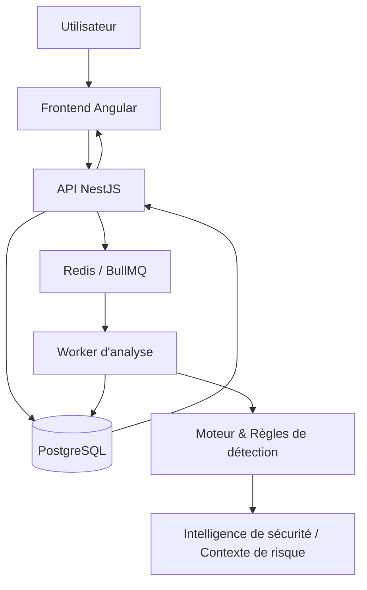

Voici la version du `README.md` expurgée de tous les émojis/stickers. La présentation reste très nette, structurée et parfaitement adaptée à un cadre académique ou professionnel d'ingénierie.

---

# SecureCode Platform

**Application Security Scanning · Vulnerability Management · Contextual Risk**

SecureCode est une plateforme de cybersécurité développée dans le cadre d'un Projet de Fin d'Études (PFA) en ingénierie. Elle centralise les contrôles de sécurité, la gestion des vulnérabilités, le contexte de risque et le suivi de la remédiation au sein d'un espace de travail unique.

Le projet repose sur une architecture **Monorepo Nx** et regroupe le code applicatif, les packages partagés, la configuration de la base de données et l'outillage de développement.

> **Note d'implémentation :** La disponibilité des fonctionnalités dépend de la branche active et de la configuration. Veuillez vérifier le comportement dans le code source et les tests avant toute utilisation opérationnelle.

---

## Sommaire

* [Présentation générale](https://www.google.com/search?q=%23pr%C3%A9sentation-g%C3%A9n%C3%A9rale)
* [Fonctionnalités et Capacités](https://www.google.com/search?q=%23fonctionnalit%C3%A9s-et-capacit%C3%A9s)
* [Architecture](https://www.google.com/search?q=%23architecture)
* [Structure du dépôt](https://www.google.com/search?q=%23structure-du-d%C3%A9p%C3%B4t)
* [Stack technologique](https://www.google.com/search?q=%23stack-technologique)
* [Guide de démarrage](https://www.google.com/search?q=%23guide-de-d%C3%A9marrage)
* [Commandes du monorepo Nx](https://www.google.com/search?q=%23commandes-du-monorepo-nx)
* [Intelligence de sécurité](https://www.google.com/search?q=%23intelligence-de-s%C3%A9curit%C3%A9)
* [Contrôle d'accès](https://www.google.com/search?q=%23contr%C3%B4le-dacc%C3%A8s)
* [Tests et Développement](https://www.google.com/search?q=%23tests-et-d%C3%A9veloppement)
* [Considérations de sécurité](https://www.google.com/search?q=%23consid%C3%A9rations-de-s%C3%A9curit%C3%A9)
* [Résolution de problèmes](https://www.google.com/search?q=%23r%C3%A9solution-de-probl%C3%A8mes)
* [Périmètre du projet](https://www.google.com/search?q=%23p%C3%A9rim%C3%A8tre-du-projet)

---

## Présentation générale

Les projets logiciels modernes peuvent présenter des vulnérabilités à différents niveaux : code source, dépendances tierces, secrets exposés, définitions de conteneurs, manifestes d'infrastructure et pipelines CI/CD. SecureCode réunit ces contrôles au sein d'un flux de travail unifié.

### Flux d'exécution type

1. **Demande :** Un utilisateur autorisé déclenche une analyse.
2. **Coordination :** L'API valide la requête et orchestre le traitement.
3. **Mise en file d'attente :** La tâche est envoyée à un service de gestion de files d'attente.
4. **Exécution :** Un worker dédié exécute les modules de détection appropriés.
5. **Stockage :** Les résultats, données brutes et métadonnées sont enregistrés.
6. **Remédiation :** Les résultats sont restitués sur l'interface utilisateur pour analyse et suivi.

---

## Fonctionnalités et Capacités

La plateforme s'articule autour des domaines fonctionnels suivants :

* **Analyses de sécurité :** Contrôles modulaires adaptés aux fichiers sources et configurations pris en charge.
* **Gestion des vulnérabilités :** Centralisation des résultats avec niveau de sévérité, classification et suivi des états.
* **Enrichissement des données :** Intégration de flux d'intelligence de sécurité externes.
* **Évaluation du risque contextuel :** Indicateurs d'aide à la priorisation des failles.
* **Traitement asynchrone :** Architecture basée sur une file d'attente pour l'exécution des tâches lourdes.
* **Gestion des accès :** Définition des identités, rôles et permissions aux niveaux organisation et projet.
* **Rapports et Historique :** Suivi temporel et audit de l'évolution de la sécurité.
* **Intégrations aux dépôts :** Connexions aux outils de gestion de version.

### Modules d'analyse supportés

| Domaine | Description |
| --- | --- |
| **SAST** | Détection de motifs de code potentiellement vulnérables. |
| **Secrets** | Identification de clés d'API, jetons ou identifiants exposés. |
| **Dépendances** | Analyse des bibliothèques tierces via des bases d'advisories open-source. |
| **Docker** | Analyse de la sécurité des fichiers de configuration de conteneurs. |
| **Kubernetes** | Contrôle de la conformité des manifestes d'orchestration. |
| **CI/CD** | Vérification de la sécurité des pipelines d'intégration continue. |
| **Configuration** | Détection de mauvaises configurations d'infrastructure. |

> **Avertissement :** Les outils d'analyse automatisée fournissent des indicateurs d'aide à la décision et ne garantissent pas l'absence totale de vulnérabilités. Les détections par règles peuvent générer des faux positifs et doivent être validées manuellement.

---

## Architecture

SecureCode s'appuie sur **Nx** pour organiser le code applicatif et les packages partagés.



### Composants principaux

* **Frontend Angular :** Interface utilisateur réactive.
* **API NestJS :** Backend assurant la validation, l'authentification et l'orchestration.
* **Redis & BullMQ :** Infrastructure de file d'attente pour le traitement asynchrone.
* **Application Worker :** Consommateur de tâches gérant l'exécution des analyses.
* **Packages de détection :** Moteur principal et règles de sécurité réutilisables.
* **PostgreSQL & Prisma :** Couche de persistance et gestionnaire ORM.
* **Utilitaires partagés :** Bibliothèques communes partagées entre les applications.

---

## Structure du dépôt

```text
securecode-platform/
├── apps/
│   ├── api/                   # API Backend NestJS
│   └── worker/                # Service de traitement d'arrière-plan
├── packages/
│   ├── scanner-core/          # Moteur d'analyse partagé
│   ├── scanner-rules/         # Règles de détection de sécurité
│   └── shared-utils/          # Utilitaires partagés
├── prisma/                    # Schémas et migrations de la base de données
├── docs/                      # Documentation technique
├── tests/fixtures/            # Jeux de données pour les tests
├── storage/                   # Répertoire de stockage local
├── .env.example               # Modèle de variables d'environnement
├── compose.yaml               # Configuration des services Docker locaux
├── nx.json                    # Configuration du monorepo Nx
├── package.json               # Dépendances et scripts du projet
├── pnpm-lock.yaml             # Verrouillage des versions des dépendances
└── README.md

```

---

## Stack technologique

| Composant | Technologie |
| --- | --- |
| **Interface Utilisateur** | Angular, TypeScript |
| **API Backend** | NestJS, TypeScript |
| **File de traitement** | Redis, BullMQ |
| **Base de données** | PostgreSQL, Prisma ORM |
| **Gestion du monorepo** | Nx, pnpm |
| **Conteneurisation** | Docker, Docker Compose |

---

## Guide de démarrage

### Prérequis

* **Git**
* **Node.js** (version LTS compatible avec le projet)
* **pnpm**
* **Docker & Docker Compose**

### 1. Cloner le dépôt

```bash
git clone <URL_DE_VOTRE_DEPOT_PRIVE>
cd securecode-platform

```

### 2. Installer les dépendances

```bash
pnpm install

```

### 3. Configurer les variables d'environnement

Copiez le fichier de configuration :

* **macOS / Linux :** `cp .env.example .env`
* **Windows PowerShell :** `Copy-Item .env.example .env`

> *Renseignez les identifiants et clés requis dans le fichier `.env`. Ne commitez jamais un fichier `.env` contenant de vrais secrets.*

### 4. Démarrer les services locaux

Lancez PostgreSQL et Redis via Docker Compose :

```bash
docker compose up -d
docker compose ps

```

### 5. Préparer la base de données

Exécutez les migrations Prisma pour initialiser la base de données :

```bash
pnpm exec prisma migrate dev

```

### 6. Lister les projets du workspace

Pour afficher l'ensemble des projets configurés sous Nx :

```bash
pnpm exec nx show projects

```

---

## Commandes du monorepo Nx

Visualiser le graphe de dépendances :

```bash
pnpm exec nx graph

```

Exécuter une cible sur un projet donné (`build`, `test`, `lint`, `serve`) :

```bash
pnpm exec nx <CIBLE> <NOM_DU_PROJET>

```

---

## Intelligence de sécurité

La plateforme peut s'interfacer avec plusieurs sources de données de vulnérabilités :

* **OSV (Open Source Vulnerabilities) :** Base de données d'advisories open-source.
* **CVE & CVSS :** Identifiants normalisés et scores de sévérité des vulnérabilités.
* **EPSS :** Estimation de la probabilité d'exploitation réelle.
* **CISA KEV :** Catalogue des vulnérabilités connues comme étant exploitées.

---

## Contrôle d'accès

Le projet implémente un modèle d'autorisations permettant d'isoler l'administration globale de la plateforme des accès propres aux organisations et aux projets.

> **Note de sécurité :** Les autorisations sont contrôlées et appliquées côté backend. Le masquage d'éléments dans l'interface utilisateur ne constitue pas une frontière de sécurité.

---

## Tests et Développement

Avant toute soumission de code, veillez à exécuter la suite de tests et de contrôle de la qualité du code :

```bash
pnpm exec nx show project <NOM_DU_PROJET>

```

---

## Considérations de sécurité

* Ne commitez jamais de clés d'API, mots de passe, certificats ou fichiers d'environnement renseignés dans le dépôt Git.
* Traitez les codes sources analysés, les journaux d'exécution et les résultats d'analyses comme des données confidentielles.
* Validez systématiquement les autorisations côté serveur.
* En cas de compromission d'un secret dans l'historique Git, procédez immédiatement à sa révocation et à sa rotation.

---

## Résolution de problèmes

* **Projet non détecté par Nx :** Vérifiez le nom exact du projet avec la commande `pnpm exec nx show projects`.
* **Échec au démarrage d'un service :** Inspectez l'état des conteneurs via `docker compose ps` et consultez les logs avec `docker compose logs`.
* **Erreur de connexion à la base de données :** Vérifiez l'accessibilité du service PostgreSQL et la chaîne de connexion figurant dans le fichier `.env`.
* **Tâches d'analyse bloquées :** Assurez-vous que le service Redis est accessible et que le process worker fonctionne correctement.

---

## Périmètre du projet

SecureCode est un projet académique développé dans le cadre d'un Projet de Fin d'Études (PFA) en ingénierie. Il illustre une approche modulaire pour l'analyse de sécurité applicative, l'enrichissement contextuel du risque et la gestion centralisée de la remédiation.
